# Düzeltmeler 16.10.2026 — tasarım taslakları

TestFlight 110 (main `e7b29bf`) incelemesinden (16.10.2026 18:53–19:12, İstanbul) gelen 6 madde için sayfaların değişiklikten **sonraki** hali. Bu yalnız bir tasarım işi: `lib/`, `test/`, `ios/` ve `garmin/` altında hiçbir şey değişmedi. Sahip taslakları onaylayınca kod görevi ayrıca açılacak.

Her sayfa için bir HTML taslağı (`*.html`, tek dosya, dış bağlantı yok) ve iki ekran görüntüsü var: `png/<ad>.png` 390×844, `png/<ad>-320.png` 320×568 (320 pt genişlik kontrolü).

Ekran görüntülerinde değişen yerler kesikli çizgiyle işaretli: mavi = yeni hali, kırmızı = kaldırılan ya da bugünkü sorunlu hali. HTML'yi adresin sonuna `#temiz` ekleyerek açarsanız işaretler gizlenir.

Taslaklar gerçek koddan okunarak çizildi: renkler `lib/ui/menzil_theme.dart` (uygulama her zaman koyu temada), kutular, kartlar ve düğmeler `lib/ui/menzil_widgets.dart` ölçüleriyle. Bu ortamda Flutter SDK olmadığı için "önce" görüntüleri de uygulamanın ekran görüntüsü değil, aynı kodun elle çizimidir. Görüntülerde yazı tipi Inter; iPhone'da SF Pro olur. Dürbün resmi ve sayılar örnektir.

## 1. Profil: "Profil ekle" düğmesi

| Önce | Sonra |
|---|---|
| 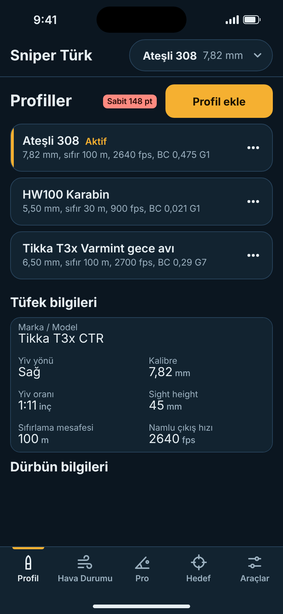 | 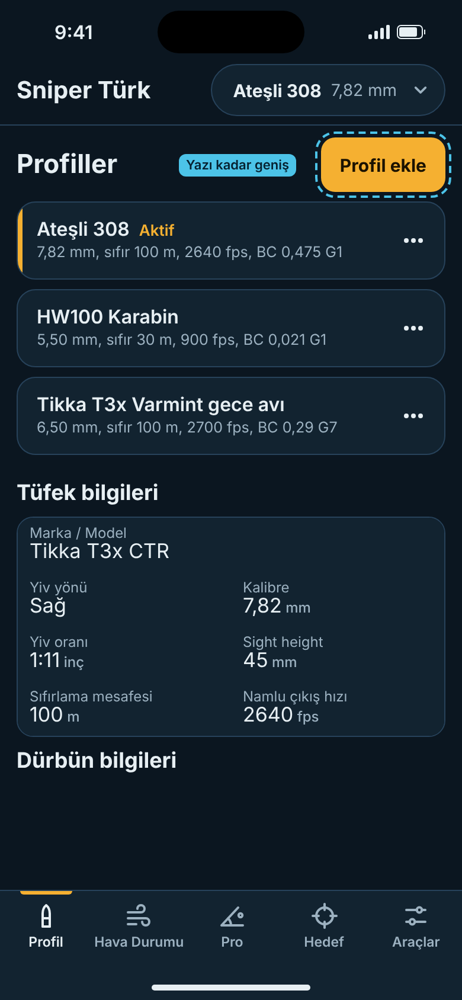 |

- **Ne değişti:** Sarı "Profil ekle" düğmesi bugün sabit 148 pt genişlikte; yazının sağında ve solunda boş sarı alan kalıyor. Yeni halinde düğme yazı kadar geniş, iki yanda 16 pt dolgu var (390 pt ekranda yaklaşık 105 pt). Yükseklik (46 pt), renk ve yer aynı kalıyor.
- **Neden:** Sahip boş sarı alanı fazla buldu.
- **Dokunulacak kod:** `lib/features/profiles/profiles_screen.dart` (~561–570): `SizedBox(width: _addButtonWidth)` sarmalı ve `_addButtonWidth = 148` sabiti silinir; `MenzilPrimaryButton(expand: false)` kullanılır. "Profiller" başlığı `Expanded` içinde kaldığı için düğme sağda durur. Çok büyük iOS yazı boyunda yazı yine tek satırda kalır (`oneLine`).

## 2 + 3. Mühimmat sıcaklığı Pro Ayarlar'a taşınıyor

| Hava Durumu önce | Hava Durumu sonra |
|---|---|
| 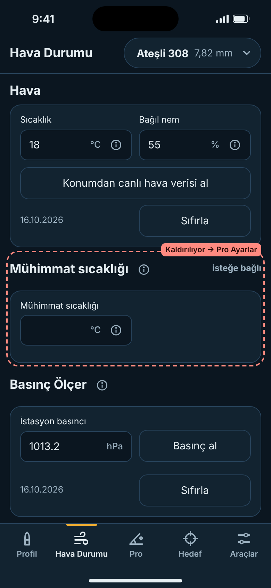 | 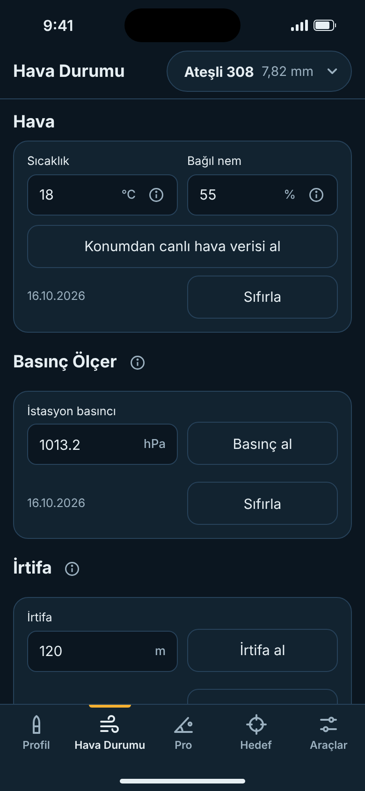 |

| Pro Ayarlar önce | Pro Ayarlar sonra (Tüfek düzeltmeleri açık) |
|---|---|
| 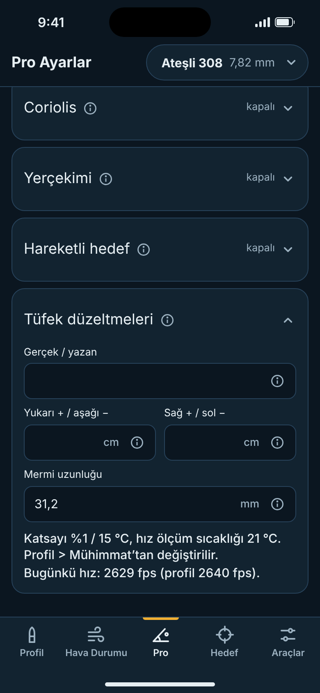 | 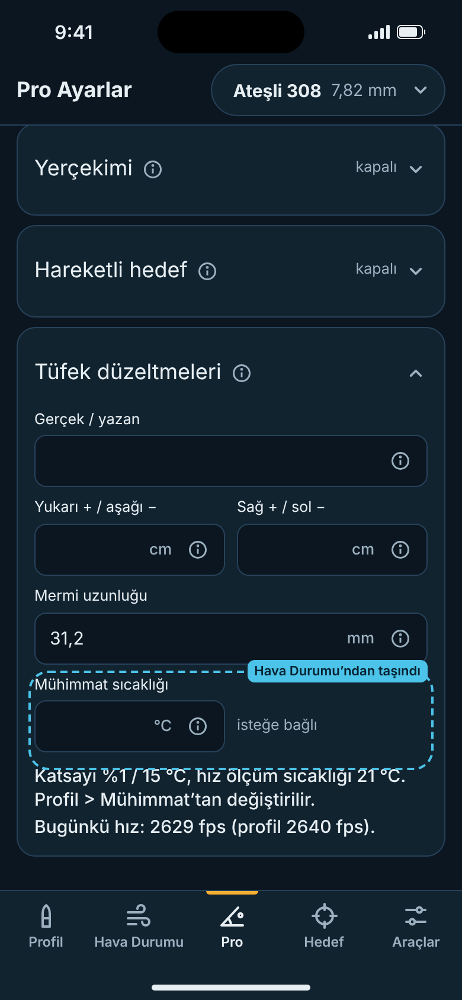 |

- **Ne değişti:** "Mühimmat sıcaklığı" bölümü Hava Durumu'ndan kalkıyor. Aynı kutu Pro Ayarlar > Tüfek düzeltmeleri içinde, Mermi uzunluğu'nun altında ve barut katsayısı yazısının ("Katsayı %… / 15 °C…") hemen üstünde duruyor. Kutu satırın sol yarısında; "isteğe bağlı" yazısı aynı satırın boş sağ yarısında, kutuyla aynı hizada. Ayrı bir başlık satırı yok.
- **Aynı kalanlar:** kutu (°C, ⓘ metni `EnvironmentFieldInfo.ammoTemperature`), kayıt anahtarı (`ammoTempText` / `ammoTempCtl`), hesap (boşsa hava sıcaklığı kullanılır) ve yalnız ateşli silahta görünmesi.
- **Neden:** Mühimmat sıcaklığı barut düzeltmesine giriyor; barut yazısı ve "Bugünkü hız" satırı zaten bu bölümde. Hava Durumu'nda hava değeri gibi okunuyordu.
- **Dokunulacak kod:**
  - `lib/features/ballistics/hava_durumu_view.dart` (~250–301): `if (_isFirearm) ...[ … ]` bloğu silinir. Silinen anahtarlar: `environment-ammo-temp-header`, `-info`, `-optional`, `-card`.
  - `lib/features/ballistics/pro_ayarlar_view.dart`, `rifle` kutusu, `if (_isFirearm) ...[` bloğunun başı: `Row[Expanded(MenzilInput(key: env-ammo-temp, controller: ammoTempCtl, onChanged: _coriolisChanged, info: …ammoTemperature, unit: °C)), SizedBox(10), Expanded(Text('isteğe bağlı', caption))]`.
  - Aynı kutunun `fields` listesine `ProInfoField('Mühimmat sıcaklığı', EnvironmentFieldInfo.ammoTemperature)` eklenir (yalnız ateşli silahta). Pro'da kutu içindeki ⓘ, kutunun alttan açılan sayfasını açar; metin aynı kalır.
  - `test/` altında bu anahtarları Hava Durumu'nda arayan testler kod görevinde Pro'ya taşınır.

## 4 + 6. Hedef: büyük klik satırı üstten kalkıyor

| Önce (390×844) | Sonra (390×844) |
|---|---|
| 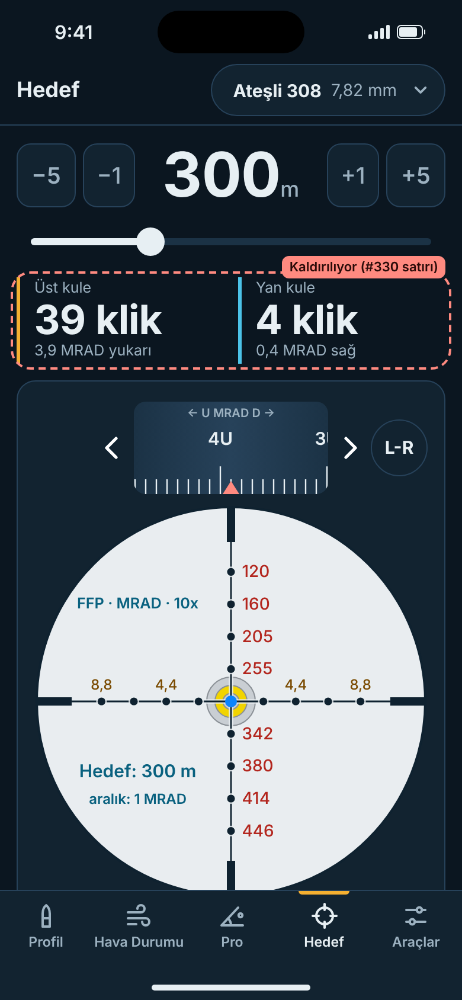 | 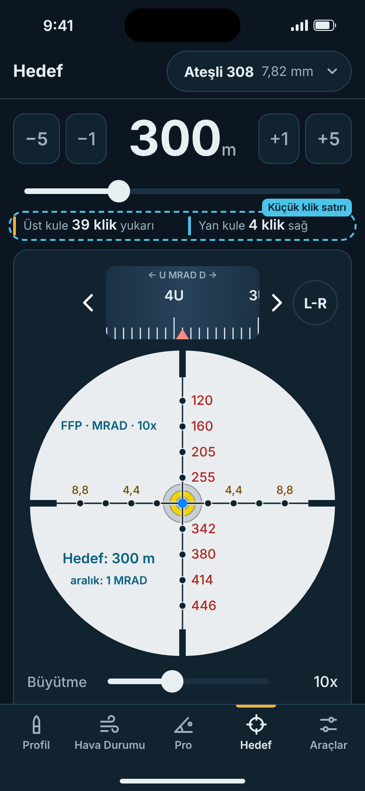 |

| Önce (320×568) | Sonra (320×568) |
|---|---|
| 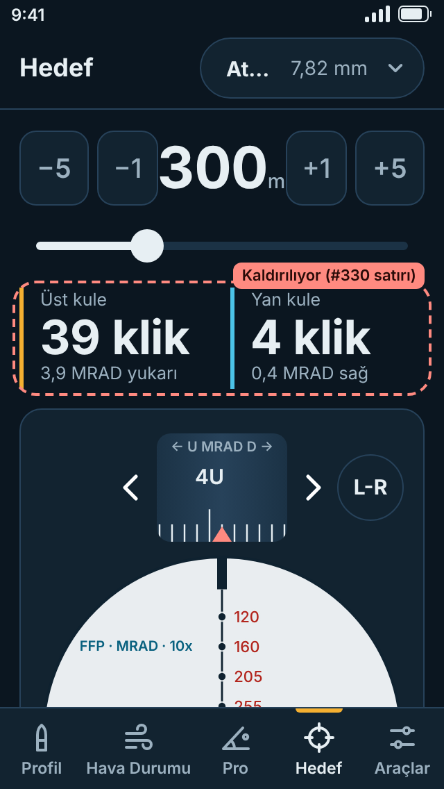 | 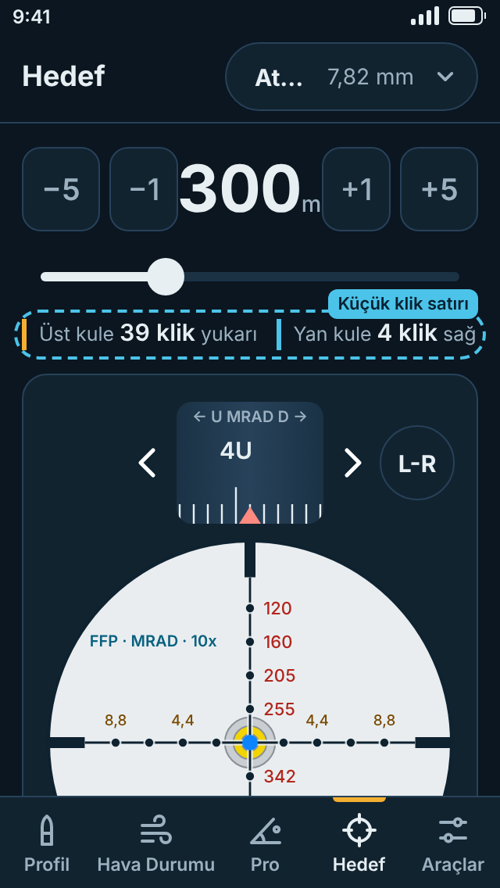 |

- **Ne değişti:** #330 ile gelen büyük "Üst kule / Yan kule" satırı (34 pt "39 klik") kaldırılıyor. Yerine kaydırıcının hemen altında **tek satır, 22 pt yüksekliğinde** küçük bir klik satırı geliyor: `▌Üst kule 39 klik yukarı   ▌Yan kule 4 klik sağ`. Sayılar 15 pt yarı kalın, yazılar 12,5 pt gri. Mesafedeki "300" ise 52 pt; klik sayıları ondan belirgin biçimde küçük. Sarı ve mavi sol çizgi eski satırdakiyle aynı (üst kule sarı, yan kule mavi). Rüzgâr girilmemişse yan taraf "Yan kule 0 klik rüzgâr yok" yazar. Dar ekranda satır iki satıra kaymaz; yazı biraz küçülür.
- **Ölçüm (taslakta):** 390×844'te dürbün bugün alt menünün 7 pt altına iniyor; altındaki Büyütme ve "Kuleleri kur" satırları görünmüyor. Ekranda bir uyarı kutusu da varsa ("Basınç irtifadan tahmin edildi" gibi) dürbünün daha büyük kısmı kayboluyor. Yeni halde dürbün alt menünün 48 pt üstünde bitiyor: mesafe, üst kule ve dürbünün tamamı kaydırmadan görünüyor.
- **320×568 (iPhone SE 1. nesil):** bu boyutta dürbün iki halde de tam sığmıyor (bugün 152 pt, yeni halde 97 pt kesik). Satır yine de iki satıra kaymadan sığıyor.
- **Sayıyı kaybetmiyoruz:** Derece/MRAD karşılığı (ör. "3,9 MRAD") bu küçük satırda yok. Dürbünün altındaki "Kule: 39 klik yukarı (3,9 MRAD) · …" satırında duruyor ("Kuleleri kur"dan sonra gereken değerle aynı). VoiceOver etiketi ("Üst kule 39 klik, 3,9 MRAD yukarı") olduğu gibi kalır.
- **Dokunulacak kod:** `lib/features/ballistics/scope_results.dart`, `TurretSolutionRow.build`: başlık, klik ve yön tek satırda, 12,5/15 pt, `FittedBox(scaleDown)`. Anahtarlar (`hedef-turret-solution`, `-elevation`, `-windage`) ve sayılar (`requiredUp` / `requiredRight`) aynı kalır. `lib/features/ballistics/hedef_view.dart` (~158–168): üst boşluk 6 → 2 pt. Hesap değişmiyor.

## 5. Üst çubuktaki profil seçici

| Bugün (sahibin anlatımına göre çizildi) | Sonra: kısa aktif ad |
|---|---|
| 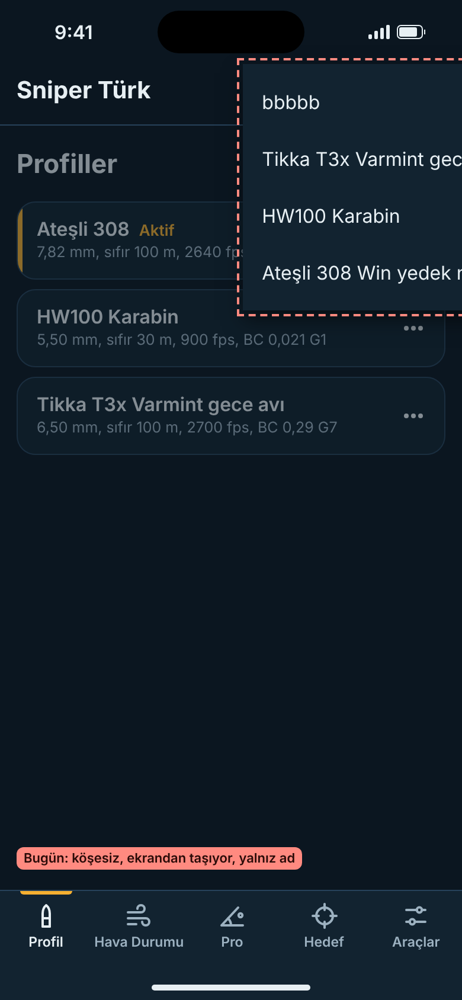 | 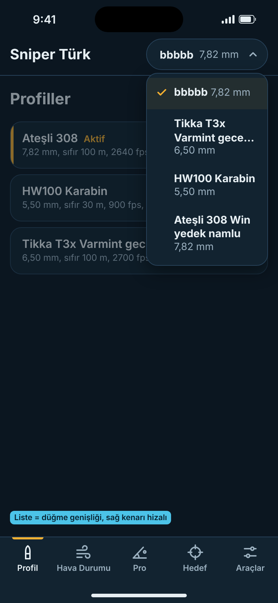 |

| Sonra: uzun aktif ad | Uzun ad, 320 pt |
|---|---|
| 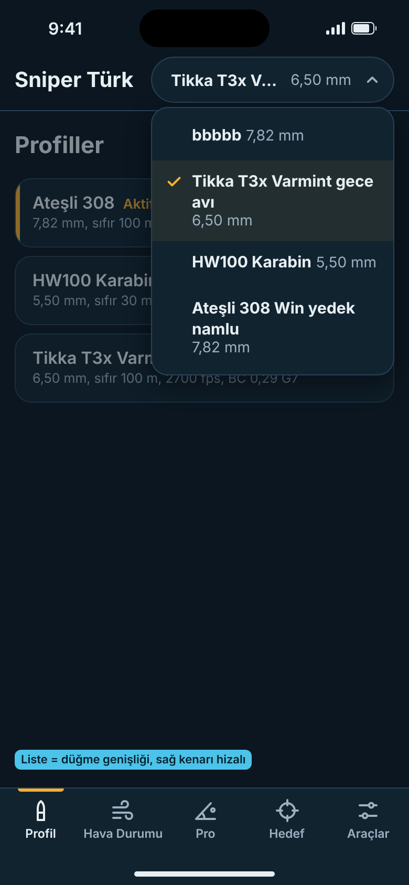 | 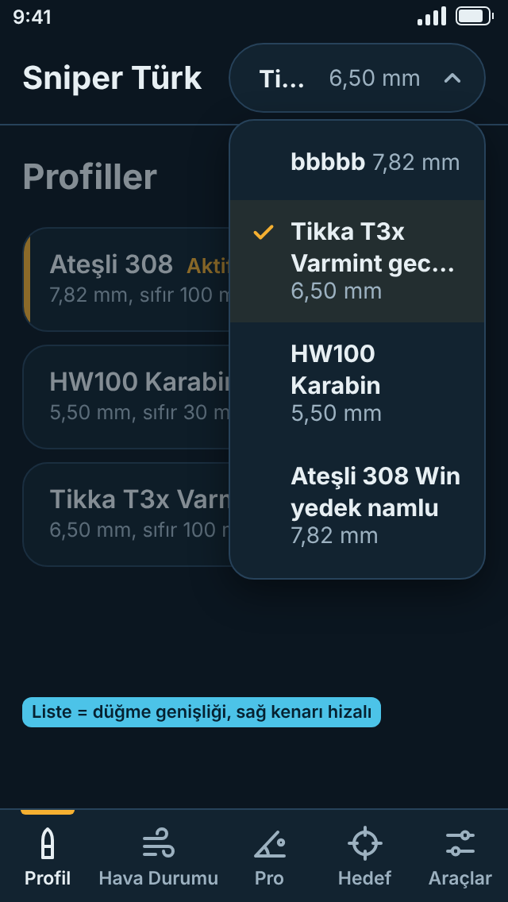 |

- **Ne değişti:**
  - Açılan liste profil düğmesinin 4 pt altında açılıyor. Sol ve sağ kenarı düğmeyle hizalı, eni düğmenin eniyle aynı: hiçbir zaman daha geniş değil, ekrandan taşmıyor.
  - Kart görünümünde: yüzey rengi, ince çerçeve, 16 pt köşe ve hafif gölge.
  - Her satırda profil adı (kalın) ve kalibresi (gri) var, düğmedeki "bbbbb 7,82 mm" gibi.
  - Aktif profilin solunda sarı ✓ var ve satırın zemini hafif sarımsı.
  - Ad ve kalibre tek satıra sığarsa yan yana durur. Sığmazsa ad en fazla iki satıra iner, gerisi "…" olur; kalibre ayrı bir satırda her zaman tam görünür.
- **UST-1 bulgusu:** Bugün kısa bir aktif ad ("bbbbb") listeyi daraltıp diğer adları kesiyordu. Yeni halde liste yine düğme kadar geniş (en az düğme eni). Ama satırlar iki satıra inebildiği ve kalibre her zaman göründüğü için "Tikka T3x Varmint gece…" ile "Ateşli 308 Win yedek namlu" ayırt edilebiliyor. Düğmede ad "Ti…" diye kısalsa bile listede hangi profilin aktif olduğu ✓ ile okunuyor.
- **Dokunulacak kod:**
  - `lib/features/home/home_screen.dart` (~546–627): `DropdownButtonFormField` yerine düğmeye bağlı bir açılır liste gelir. `MenzilSelect`'in `_MenzilMenuRoute` / `_MenzilMenuLayout` mantığı (kutunun altında, kutu eninde) aynen kullanılır.
  - `lib/ui/menzil_widgets.dart`: bunun için bu düzen herkese açık, küçük bir bileşen olarak dışarı alınır.
  - Satır bileşeni: ✓ + ad + kalibre, `_caliberLabel` ile.
  - Düğmenin kendisi (genişlik, ad kısaltma, kalibre) değişmiyor.

## Açık sorular (yalnız gerçek seçimler)

1. **Liste köşesi:** 16 pt (kart köşesi, istenen "kart görünümü"; taslaktaki) mı, yoksa uygulamadaki diğer açılır listelerin 10 pt köşesi mi?
2. **Hedef klik satırının yeri:** kaydırıcının altında tek satır (taslaktaki, 22 pt ek yer) mı? Yoksa üst kule satırındaki boş 48 pt'lik sol yuva (üst kule klikleri) ve L-R düğmesinin altı (yan kule klikleri) mı? İkincisi hiç ek yer tutmaz ama 3 basamaklı sayılarda çok sıkışır.
3. **Pro özeti:** Tüfek düzeltmeleri kutusu kapalıyken "N ayar açık" özeti, girilmiş bir Mühimmat sıcaklığını da saysın mı (evet / hayır)? Kutu artık bu alanı içerdiği için taslakta "evet" varsayıldı; bugün sayılmıyor.

## Değişmeyenler

- Hiçbir hesap, formül, kayıt anahtarı, birim ya da ⓘ metni değişmiyor. Kayıtlı Mühimmat sıcaklığı değeri olduğu gibi yüklenir.
- Hava Durumu'nun Sıcaklık, Bağıl nem, Basınç Ölçer, İrtifa ve Rüzgâr bölümleri aynı.
- Hedef'te dürbün boyutu, kuleler, L-R, "Kuleleri kur" / "Kuleleri sıfırla", hesap dökümü ve DOPE PDF aynı.
- Profil düğmesinin yüksekliği, rengi, yeri; profil kartları ve özet kartları aynı.
- Üst çubuktaki profil düğmesinin kendisi aynı.
- Yeni bağımlılık yok, kod yok. TestFlight yok.

---
_Generated by [Claude Code](https://claude.ai/code)_
