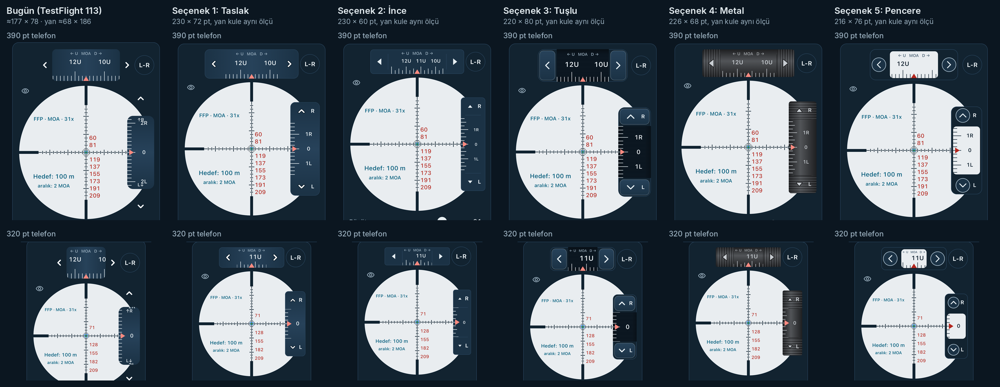

# Kule tasarımı: 5 seçenek (Hedef sayfası)

Sahibin isteği (17.10.2026, İstanbul): 21:10 "Kuleleri biraz büyütelim, boyutlar eşit olsun", 21:07 oklar kulenin İÇİNDE olsun, 21:16 "biraz daha uzat yan kuleyi, üst kule sanki çok tombul", 21:17 "5 tane hazırlasın, tasarım eklentisi".

Bu yalnızca bir tasarım çalışmasıdır. Uygulama değişmedi: bugünkü kule aynen duruyor. Beş seçenek sadece ekran görüntüsü testi açıkken çizilir (aşağıda "Nasıl yapıldı").

Görüntüler gerçek uygulamadan alındı: iPhone 16e Simülatörü (iOS 26.2), koyu tema, Hedef sayfası, "Kuleleri kur" basılmış hali (üst kule 45 klik yukarı, yan kule 0). Profil: Gazi Sniper 6–36×56 FFP, MOA. 320 pt görüntüsü, aynı Simülatörde 320 × 568 pt'lik bir çerçevenin içinde çizildi.

## Her seçenekte ortak olanlar

- Üst kule ile yan kule tam aynı boyda. Yan kule, üst kulenin 90° döndürülmüş hali.
- Oklar kulenin içinde, iki ucunda kendi bölmelerinde. Her ok bölmesi en az 44 × 44 pt. Sayılar ve ölçek yalnız iki ok bölmesinin arasındaki pencerede çizilir, ok hiçbir sayıyı kapatmaz. Pencerenin ucunda yarısı kesilecek bir sayı hiç çizilmez.
- Yan kulede R ve L harfi artık okun yanında, ok bölmesinin içinde. Böylece yan kulenin sayı penceresi boydan boya sayılara kalıyor.
- Bilgiler bugünküyle aynı: ← U · MOA/MRAD · D → başlığı, U/D ve R/L harfleri, sayılar, çentikler, kırmızı sıfır işareti.
- Üst kule retikülün dikey çizgisinin tam üstünde, L-R düğmesi yerinde. Yan kulenin sağ kenarı retikül karesinin sağ kenarında, ortası yatay çizgide (bugünkü gibi).
- Her şey retikülle birlikte küçülür (k = retikül / 334). Üst kule hiçbir zaman L-R düğmesine taşmaz: 390 pt'de en fazla 230 pt uzunluk sığar (334 − 2 × (48 + 4)). Dar telefonda iki kule birlikte küçülür, kalınlık 44 pt'nin altına inmez.
- Sürükleme hızı, klik sesi ve hesap aynı; yalnız görünüş değişir.

## Seçenekler

**Seçenek 1: Taslak** ([390 pt](secenek_1_390.png), [320 pt](secenek_1_320.png)). 230 × 72 pt (320 pt telefonda 160 × 50 pt). Ana oturumun taslağının aynısı: bugünkü beyaz ok (koyu kenarlı ‹ ›, ^ v) kulenin içine, iki uca alındı; gövde bugünkü gibi ortası açık, uçları koyu gölgeli. Ok bölmesi 44 pt. Artısı: bugünkü kuleye en yakın görünüş, sahibin beğendiği yön, en uzun ve en ince oranlı seçeneklerden biri (tombulluk gider). Eksisi: oklar düğmeye benzemiyor, dokunma alanı gözle görülmüyor.

**Seçenek 2: İnce** ([390 pt](secenek_2_390.png), [320 pt](secenek_2_320.png)). 230 × 60 pt (320 pt'de 160 × 44 pt). Düz gövde, ince çerçeve; ok yerine küçük dolu üçgen, ok bölmesi ince bir çizgiyle ayrılmış. Sayılar küçük (12 pt) ve sık: her 1 MOA'da bir sayı, iki sayının ortasında yarım çentik. Artısı: en ince ve sade kule, retikülü en az kapatan seçenek, aynı anda en çok sayı görünür. Eksisi: sayılar küçük; dar telefonda kalınlık 44 pt'ye dayanır.

**Seçenek 3: Tuşlu** ([390 pt](secenek_3_390.png), [320 pt](secenek_3_320.png)). 220 × 80 pt (320 pt'de 160 × 58 pt). Uçlarda kabarık, düğme gibi tuşlar (ok tuşun üstünde), aradaki sayı penceresi daha koyu ve içe gömük. Sayılar büyük (17 pt), seyrek. Ok bölmesi 46 pt. Artısı: neye dokunulacağı en açık seçenek, sayılar en kolay okunan. Eksisi: en kalın kule; sahip üst kuleyi "tombul" bulduğu için bu yöne ters düşebilir.

**Seçenek 4: Metal** ([390 pt](secenek_4_390.png), [320 pt](secenek_4_320.png)). 226 × 68 pt (320 pt'de 160 × 48 pt). Koyu metal silindir gölgesi (temanın drumDark / drumLight renkleri), uçlarda tırtıklı tutma yeri ve üstünde dolu üçgen ok. Sayıların arasında yarım çentik. Artısı: gerçek bir dürbün kulesi hissi, tutulacak yer belli. Eksisi: uygulamanın geri kalanındaki lacivert yüzeylerden ayrı duruyor; gri gövdede sayıların kontrastı diğerlerinden düşük.

**Seçenek 5: Pencere** ([390 pt](secenek_5_390.png), [320 pt](secenek_5_320.png)). 216 × 76 pt (320 pt'de 160 × 56 pt). Lacivert gövdede, dürbünün iç rengine benzeyen açık renkli sayı penceresi; sayılar koyu, sıfır işareti koyu kırmızı. Oklar yuvarlak halka düğmelerin içinde. Artısı: sayılar retikülle aynı renk düzeninde, çok net. Eksisi: açık pencere koyu temada göze en çok batan parça; pencere kısa olduğu için 390 pt'de bile üst kulede çoğu zaman tek sayı görünüyor, 320 pt'de pencere çok daralıyor.

## Önerim

**Seçenek 1 (Taslak).** Sahibin beğendiği yön bu; bugünkü kulenin rengi ve oku korunuyor, yalnız oklar içeri giriyor ve iki kule eşit oluyor. 230 × 72 pt ile üst kule bugünkünden (≈177 × 78) uzun ve ince, yan kule bugünkünden (≈68 × 186) uzun; "tombul" ve "yan kuleyi uzat" isteklerinin ikisi de karşılanıyor. Sahip daha ince isterse ikinci tercih Seçenek 2 (230 × 60).

## Uç durumlar ve bilinen sınırlar

- 320 pt telefonda her seçenek 160 pt uzunluğa iner (L-R düğmesine yer kalsın diye) ve ok bölmeleri 44 pt kaldığı için sayı penceresi 72 pt olur: üst kulede genelde tek sayı, yan kulede çoğu zaman yalnız "0" (ya da en yakın sayı) görünür. Çentikler her zaman görünür. Sayı hiç kesik çizilmez.
- Dar pencerede sayı aralığı kendiliğinden sıklaşır (en az bir sayı görünsün diye). MRAD dürbünde bu gerekirse 0,5 mrad'lık ara sayılara iner.
- Yan kulenin sayı penceresi, bugünkü gibi retikülün sağ kenarını örter; L-R ile gizlenir.
- 240 pt uzunluk denenmedi: 390 pt telefonda L-R düğmesi yerinde kaldıkça en fazla 230 pt sığıyor.

## Bilerek yapılmayanlar

- Uygulamadaki kule değişmedi; hiçbir seçenek uygulamada açılmıyor. Seçilen seçenek ayrı bir görevle uygulanmalı (o görevde tasarım anahtarı ve kullanılmayan seçenekler koddan silinir).
- Klik sesi (21:03), hesap, sürükleme hızı ve başka sayfalar değişmedi.
- Başka bir uygulamanın kulesi örnek alınmadı; renkler uygulamanın kendi koyu tema renkleri (MenzilColors), yazı tipi uygulamanınki.

## Nasıl yapıldı

- `lib/features/ballistics/scope_turret_designs.dart` (yeni): `TurretStyle` (current + 5 seçenek), `TurretStyleScope` (yalnız testlerin kullandığı tasarım anahtarı), `TurretDesign` ölçüleri, uç bölme ve sayı penceresi çizimi.
- `scope_turrets.dart`: kule çubuğu ve kule tamburu, `TurretStyleScope` varsa tasarım yolunu çizer; yoksa bugünkü kod aynen çalışır. L-R düğmesi aynı kodla `toggle()` yöntemine taşındı (görünüş ve davranış aynı).
- `test/kule_secenekleri_test.dart` (yeni): her seçenek için 390 ve 320 pt'de: iki kule aynı boy (±0,5 pt), 390'da tam ölçü (Seçenek 1 = 230 × 72), dört ok bölmesi ≥ 44 × 44 pt ve kulenin içinde, sayı penceresi iki bölmenin arasında, üst kule retikülün ortasında, yan kulenin sağ kenarı retikülün sağ kenarında, L-R düğmesine taşma yok, taşma hatası yok, oklar 1 klik çeviriyor. Ayrıca bugünkü kulenin ölçülerinin anahtar olmadan ve "current" ile birebir aynı kaldığı.
- `integration_test/kule_secenekleri_screens_test.dart` (yeni): Simülatörde gerçek uygulamayı her seçenekle açıp ekran görüntüsü alır (sim-screens iş akışı).

## Testler ve CI

- Yerel: `python3 tools/offline_dart_lint.py` geçti (436 Dart dosyası, 0 sorun); `python3 -m unittest discover -s tools -p 'test_*.py'` geçti (915 test, 1 atlanan).
- Bu ortamda Flutter SDK indirilemediği için (storage.googleapis.com engelli) `flutter analyze` ve `flutter test` yalnız GitHub Actions'ta çalıştı. Bağlantılar PR açıklamasında.
