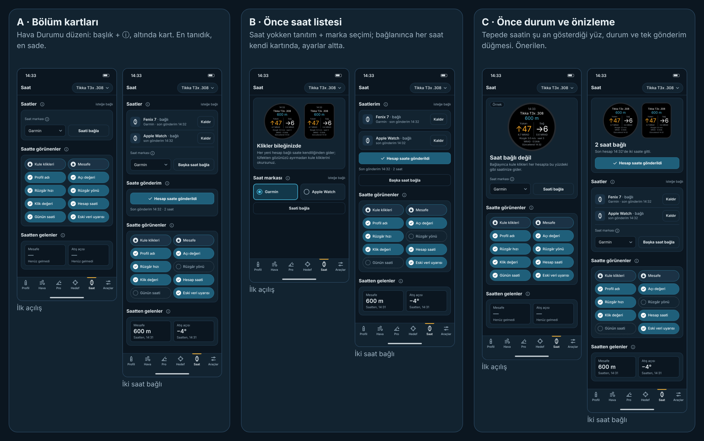

# Saat sayfası — üç tasarım seçeneği (2026-10-16)

Yalnız tasarım. `lib/`, `test/`, `ios/`, `garmin/` altında hiçbir şey değişmedi; kod ya da yeni bağımlılık yok.
Hepsi bir arada: [`index.html`](index.html). Canlı taslaklar: [`secenek-a.html`](secenek-a.html), [`secenek-b.html`](secenek-b.html), [`secenek-c.html`](secenek-c.html).

## Kısa özet (5 satır)

1. Saat, alt menüde Hedef ile Araçlar arasına giren 6. sayfa; başlığı "Saat".
2. Garmin ve Apple Watch aynı anda bağlanır; her yeni hesap bağlı saatlere kendiliğinden gider.
3. Tek gönderim düğmesi var: tamamsa "Hesap saate gönderildi" (koyu mavi, ✓), gönderilemezse "Hesabı saate gönder".
4. "Saatte görünenler"de 10 bilgi var: Kule klikleri ve Mesafe kilitli, diğer 8'i açılıp kapanır. "Saatten gelenler"de saatten gelen Mesafe ve Atış açısı durur.
5. Saati olmayan kullanıcı da ne kazanacağını görmeli; Pro üyelik geldiğinde kilit hiçbir şey kaydırılmadan eklenebilmeli.

## Hepsinde ortak

- Renkler, yazı boyları, köşe yarıçapları `lib/ui/menzil_theme.dart` ile aynı. Üst çubuk, kart, bölüm başlığı + ⓘ, kutu, düğme ve ⓘ alt sayfası `menzil_widgets.dart`, `hava_durumu_view.dart` ve `pro_info_sheet.dart` ile aynı.
- Düğme rolleri: çerçeveli düğme eylemdir ("Saati bağla", "Kaldır"); koyu mavi ve ✓ işaretli düğme tamamlanmış işi gösterir ("Hesap saate gönderildi"); beyaz dolu düğme yalnız alt sayfadaki "Kapat". Turuncu yalnız küçük vurguda kullanıldı: menü çizgisi, uyarı kenarı, "yanıt yok" yazısı ve saat yüzündeki Yukarı kliki.
- **Bilgi çipleri yeniden tasarlandı.** Açık çip koyu mavi zemin, beyaz dolu daire ve ✓. Kapalı çip kesik çizgili çerçeve ve boş gri halka. Kilitli çip (Kule klikleri, Mesafe) beyaz dairede kilit. Renk görmeyen biri de üç durumu ✓, boş halka ve kilitten ayırır. Çipler ikişer ikişer dizili ve 44 pt yüksek. 320 pt'de "Eski veri uyarısı" yazısı kutusunun içinde "Eski veri" olarak kısalır.
- Seçilen sekiz bilgi saat yüzündeki yerlerinden geliyor (`docs/saat-uygulamasi/taslak`): Profil adı, Açı değeri (4.7 MRAD), Rüzgâr hızı, Rüzgâr yönü (saat 3), Klik değeri (MRAD · 0.1/klik), Hesap saati (Güncellendi 14:32), Günün saati (14:33) ve Eski veri uyarısı. Hepsi `WatchSolution.toMap` içinde zaten var.
- ⓘ metinleri kısa ve Türkçe; her biri ne olduğunu, nerede bulunduğunu söyler ve örnek verir. Saat markası, Garmin adımları, Apple Watch adımları, Saate gönderim, Saatte görünenler ve Saatten gelenler için ayrı metin var. "Saati kullanmazsanız hiçbir ayarınız ve hesabınız değişmez." cümlesi yalnız ⓘ içinde geçer (Saatler / Saat markası / Garmin / Apple Watch / Saatten gelenler). Alanların altında açıklama yazısı yok.
- Saatler bölümünde sağda "isteğe bağlı" yazar (Pro'daki "Garmin saati" satırıyla aynı).
- **Alt menü 6 düğme:** 320 pt'de her düğmeye ~53 pt düşüyor; "Hava Durumu" sığmıyor ve 7 pt'ye kadar küçülüyor. Önerim etiketi **"Hava"** yapmak; sayfa başlığı "Hava Durumu" olarak kalır. Bkz. [`png/alt-menu-320.png`](png/alt-menu-320.png). Saat simgesi diğer simgelerle aynı 24'lük ızgarada, 2 pt çizgiyle çizildi.
- Apple Watch'un adı iPhone'dan okunamıyor (WatchConnectivity ad vermiyor). Bu yüzden listede "Apple Watch · bağlı" yazar; Garmin'in adı Garmin Connect'ten gelir ("Fenix 7").

## Seçenek A — Bölüm kartları

**Fikir:** Hava Durumu'nun düzeninin aynısı. Başlık + ⓘ ve altında bir kart; sırasıyla Saatler, Saate gönderim, Saatte görünenler ve Saatten gelenler. Saat markası kutusu ile "Saati bağla" düğmesi, Basınç Ölçer'deki "İstasyon basıncı | Basınç al" gibi aynı satırda duruyor. Saat bağlanınca aynı düğmenin adı "Başka saat bağla" olur.

- Artıları: en tanıdık ve en sade seçenek; kodlaması en kolay, neredeyse hep mevcut parçalar kullanılıyor.
- Eksileri: saati olmayan kullanıcıya "ne kazanırım" diye bir şey göstermiyor, ilk açılış bir ayar sayfası gibi duruyor. Satın almaya en az teşvik eden seçenek bu.

## Seçenek B — Önce saat listesi

**Fikir:** Sayfa bağlı saatlerin listesiyle açılır ve her saat kendi kartında durur. Gönderim sorunu o saatin kartında görünür, gönderim düğmesi listenin hemen altındadır. Saat yokken tepede iki gerçek saat yüzü (Garmin yuvarlak ve Apple Watch) ile "Klikler bileğinizde" tanıtımı, altında iki büyük marka kutusu (Garmin | Apple Watch) ve "Saati bağla" var. Ayarlar ilk saat bağlanınca görünür.

- Artıları: boş ekran satış yapıyor; hangi saatte sorun olduğu kartından hemen anlaşılıyor; marka seçimi tek dokunuş.
- Eksileri: bağlandıktan sonra tanıtım kayboluyor ve sayfa A'ya benziyor. "Başka saat bağla" ile "Hesabı saate gönder" iki çerçeveli düğme olarak alt alta duruyor. Bağlıyken marka seçimi için ek bir alt sayfa gerekiyor (çizilmedi).

## Seçenek C — Önce durum ve önizleme (önerilen)

**Fikir:** Sayfanın tepesinde saatin şu anda gösterdiği yüz durur; iki saat bağlıysa iki yüz yan yana. Altında büyük durum yazısı ("2 saat bağlı", "Fenix 7'ye gönderilemedi") ve tek gönderim düğmesi var. "Saatte görünenler"de bir bilgiyi kapatınca o bilgi önizlemeden de kalkar; örnek ekranlarda Rüzgâr yönü ve Günün saati kapalı. Saat yokken aynı yüz "Örnek" etiketiyle görünür, marka ve "Saati bağla" hemen altındadır.

- Artıları: saat olmadan da ne alınacağı en açık bu seçenekte görünüyor (satın almaya en çok teşvik eden). Durum ve tek düğme başparmağın ulaştığı yerde. Çip seçiminin sonucu anında görülüyor. Hata olunca kart turuncu kenar alıyor, sorunlu saatin yüzü kararıyor ve "Güncellendi 14:20" gösteriyor.
- Eksileri: saat yüzü önizlemesi yeni bir parça, kodlaması A'dan zor. Küçük yüzdeki yazılar okunmak için değil, tanınmak için; asıl okuma saatte yapılıyor.

## Karşılaştırma

| | A Bölüm kartları | B Önce liste | C Önce durum |
|---|---|---|---|
| Anlaşılırlık | İyi | İyi | **Çok iyi**: saatin ne göstereceği ekranda |
| Satın almaya teşvik | Zayıf | İyi (yalnız boşken) | **Çok iyi** (her durumda) |
| Diğer sayfalarla uyum | **Çok iyi** (Hava Durumu ile aynı) | İyi | İyi (kartlar ve düğmeler aynı, önizleme yeni) |
| Tek elle kullanım | Orta (gönderim ortada) | İyi | **Çok iyi** (durum + düğme üstte, tek kartta) |
| Kodlama zorluğu | **Kolay** | Orta | Orta–zor (önizleme parçası) |

## Önerim: C

Bu sayfanın işi, Pro'yu satın aldıracak özelliği göstermek. C hem saati olmayana hem saati olana aynı şeyi gösteriyor: bileğe gelecek olan ekranın kendisini. Saati olan için de sayfanın en önemli sorusu "son hesap saate gitti mi?". C bunu tepede tek cümle ve tek düğmeyle cevaplıyor. Aşağıdaki bölümler A ile aynı parçalar, yani diğer sayfalarla uyum korunuyor. Önizleme için saat ekranlarının tasarımı zaten hazır (`docs/saat-uygulamasi/taslak`); yeniden tasarlamak gerekmiyor, küçültülmüş hali kullanılıyor.

## Pro üyelik kilidi nereye takılır (şimdi rozet yok)

Hiçbir şey yer değiştirmeden iki yere takılabilir:

1. Saatler bölümünün sağındaki **"isteğe bağlı"** yazısı, ileride "Pro" rozeti olur.
2. **"Saati bağla" düğmesi**: üye olmayan dokunduğunda bağlantı akışı yerine üyelik alt sayfası açılır. Düğmenin yeri, adı ve şekli aynı kalır.

C'de önizleme ve çipler kilitliyken de görünmeye devam eder; satın almaya teşvik eden kısım da zaten bu.

## Gereken kayıt anahtarları (öneri)

Bugün kodda saat ile ilgili hiçbir kayıt anahtarı yok. Yeni anahtarlar sürüm ekiyle açılır; olmayan anahtar varsayılanı verir, bu yüzden eski kayıtlar sorunsuz yüklenir ve silinmez.

| Anahtar | İçerik | Yoksa |
|---|---|---|
| `watch.devices.v1` | Bağlı saatler: marka, kimlik, ad, eklenme ve son gönderim zamanı | Boş liste (ilk açılış) |
| `watch.fields.v1` | Kapalı bilgi çiplerinin kimlikleri (`profile`, `angle`, `wind`, `dir`, `click`, `calc`, `clock`, `stale`) | Hepsi açık; `clicks` ve `range` hiç saklanmaz, hep açık |
| `watch.lastSend.v1` | Son gönderim: zaman, sonuç (tamam / gönderilemedi), saat başına sonuç | Gönderim yok |
| `watch.received.range.v1` | Saatten gelen mesafe: değer, birim, zaman | "—", Henüz gelmedi |
| `watch.received.angle.v1` | Saatten gelen atış açısı: değer, zaman (park edilmiş PR #354) | "—", Henüz gelmedi |
| `watch.brand.last.v1` | Son seçilen saat markası | Garmin |

Garmin'in seçili saatleri Garmin Connect'te tutulur; `watch.devices.v1` yalnız ad ve son gönderim zamanını ekler. Bilinmeyen ya da eski bir çip kimliği sessizce atlanır.

## Tasarlanmayanlar

- Saat ekranlarının kendisi (ayrı tasarlandı), uygulama kodu ve testler.
- "Saati bağla"ya dokunduktan sonraki ara durumlar: Garmin Connect'in açılması, Apple Watch'ta uygulamanın açılmasının beklenmesi, "Kaldır" onayı. Bağlıyken marka seçimi için B'deki ek alt sayfa da çizilmedi.
- Pro'daki "Garmin saati" satırının kaldırılması (Saat sayfası gelince o satır silinmeli; ayrı görev).
- Üyelik ekranı ve kilitli durumun görünümü.
- Açık tema ve büyük yazı boyutu denetimi.

## Dosyalar ve yeniden üretme

- `png/{a,b,c}-{1,2,3,4}.png`: 1 ilk açılış, 2 bir Garmin bağlı ve gönderildi, 3 Garmin + Apple Watch, 4 gönderilemedi.
- `png/{a,b,c}-320.png` 320 pt denetimi (3. durum); `png/{a,b,c}-bilgi.png` ⓘ alt sayfası (A: Garmin adımları, B: Apple Watch adımları, C: Saatte görünenler).
- `png/alt-menu-320.png` alt menü karşılaştırması; `png/yan-yana.png` üç seçenek yan yana.
- Görüntüler 390 pt genişlikte, 2× piksel yoğunluğunda (780 px). Uzun sayfalar 844 pt'den uzun çekildi, alt menü sayfanın sonunda. Yazı tipi iPhone'da sistem yazısı (SF); bu makinede onun yerine en yakın yazı olan Inter kullanıldı.
- Yeniden üretmek için: `node uret.mjs` (önceden kurulu Chromium + Playwright). Kaynaklar `kaynak/` klasöründe; `secenek-*.html` dosyaları tek parça olarak üretilir.

---
🤖 Generated with [Claude Code](https://claude.com/claude-code)
