# Tasarım: Saha sayfası ve Terazi (bir sonraki sürüm için)

Tarih: 16.10.2026, 15:36 (İstanbul). Sahibin kararları: 16.10.2026 14:19–15:27, "Başlat" 15:27.
Bu yalnız tasarımdır. `lib/`, `test/`, `ios/`, `garmin/` altında değişiklik yok; hesap değişmez; yeni paket yok.
Şu anki TestFlight için değil, bir sonraki sürüm içindir. Sahip onaylayınca ayrı bir kod görevi açılır.

Görseller 390 × 844 pt (2x PNG), bir tanesi 320 pt genişlik denetimi. Hepsi bu klasördeki `.html`
dosyalarından Chromium ile çizildi; dosyalar kendi başına açılır (dış dosya yok).
Renkler ve kutular `design/clean-2026-10-15` README'sindeki onaylı kurallardan: zemin #0B1620, kart #122330,
çizgi #27425A, yazı #E7EFF3, ikinci yazı #9CB1C0, ana düğme #F5B031, açık mavi #4CC3E8, uyarı #FF8A80,
"alındı" koyu mavi #1F5F7A / #2E7FA0. Turuncu #E8590C yalnız rüzgâr halkasındaki oktadır.

Başka bir balistik uygulamadan (incelenen Wrist Dope dahil) düzen, metin, ad, simge, renk, ses veya veri
alınmadı. Yalnız özellik fikri alındı. Hedef boyutları ve eğim etkisi örnekleri için hiçbir dış sayı yok.

## Amaç

1. **Saha**: sahada telefonla hedefin yönünü ve açısını, rüzgârın yönünü ve hızını tek ekranda ölçüp
   kilitlemek; kilitlenen değerler bugünkü hesap kutularına yazılır (Coriolis Atış yönü, Açı, Rüzgâr).
2. **Terazi**: tüfeğe takılan telefonun tüfeğin yatıklığını uzaktan, bir bakışta okunur göstermesi;
   istenirse atış anında Hedef sayfasında renk ve sesle uyarması, istenirse atış açısını vermesi.

## Pro kararı (sahip, 16.10.2026)

Bugün ücretli üyelik yok. **Tek tasarım** var:

- Pro özellikleri sayfada son yerlerinde durur, görünür, çalışır ve **herkes için varsayılan AÇIK** gelir.
- "PRO" rozeti yok, satın alma ekranı yok.
- İleride üyelik sistemi gelince bu anahtarlar üyeliğe bağlanır; hiçbir şey yer değiştirmez.
- Bu tasarımdaki Pro özellikleri: Saha sayfasının tamamı, "Atışta teraziyi göster", "Açıyı teraziden al",
  Terazi ayarlarındaki Hassasiyet / En büyük açı / Ses tonu / Gösterge.
- Kod görevine not: her özellik tek bir yerden açılıp kapanabilmeli (bugün hep açık). Bu, "gizle" bayrağı
  değildir; kullanılmayan özellik silme kuralı değişmez.

## Ekranlar

### A) Saha (tek ekran)

| Görsel | Durum |
|---|---|
| 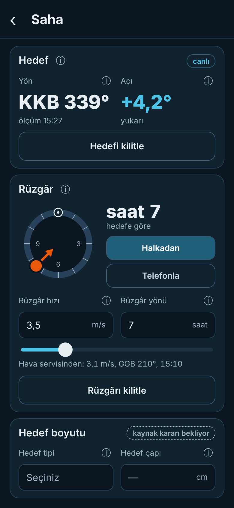 | Hedef canlı, rüzgâr halkadan sürükleniyor |
| 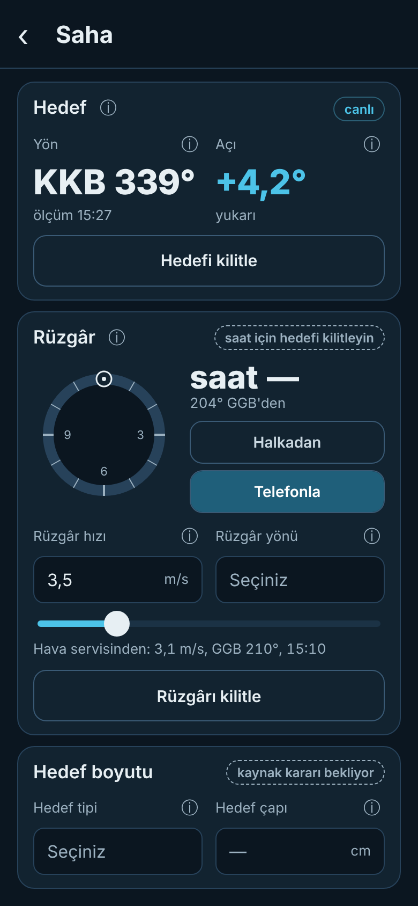 | Hedef kilitli değil, rüzgâr "Telefonla": derece var, saat yok |
| 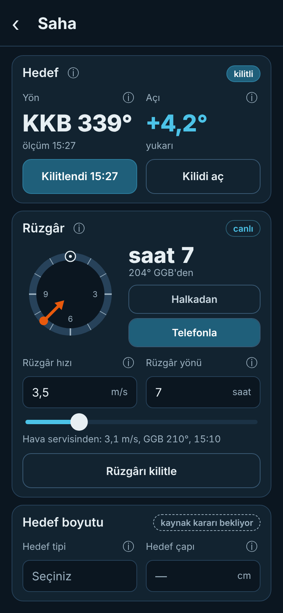 | Hedef kilitli, rüzgâr telefonla canlı ölçülüyor |
| 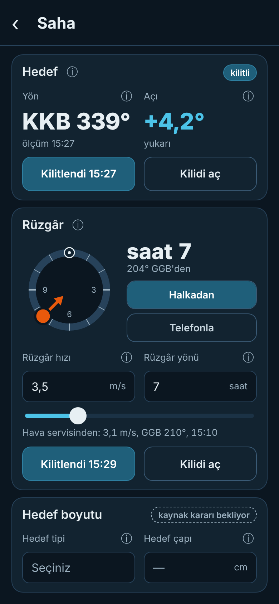 | Hedef ve rüzgâr kilitli |
| 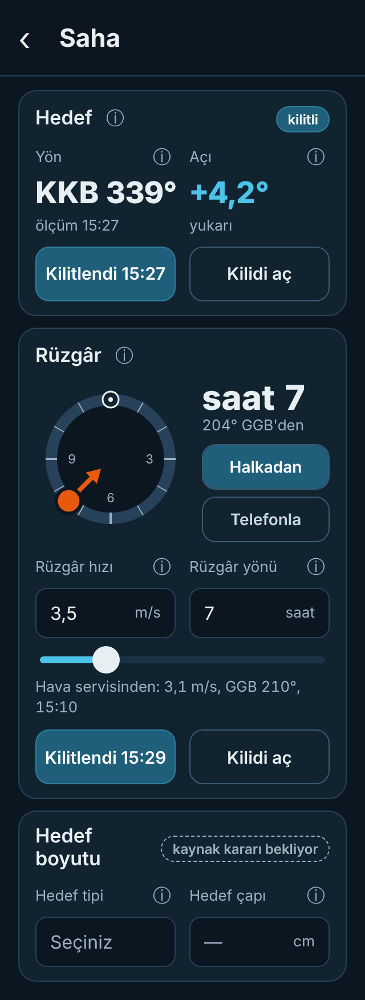 | 320 pt genişlik denetimi (taşma yok; içerik uzar, sayfa kayar) |

**Hedef kartı**
- Telefon hedefe tutulur. **Yön**: yön harfi + derece (ör. "KKB 339°"), altında ölçüm saati (İstanbul).
  **Açı**: "+4,2° yukarı" açık mavi #4CC3E8, "−3,0° aşağı" amber #F5B031 (iki ayrı renk).
- Sağ üstte "canlı" / "kilitli" etiketi.
- "Hedefi kilitle" → değerler donar; düğme "Kilitlendi 15:27" (koyu mavi, "alındı" kuralı) + "Kilidi aç".
- Kilitlenince: yön → Pro Ayarlar Coriolis **Atış yönü** (bugünkü `azimuthText`, "Pusuladan alındı"
  hâliyle); açı → Pro Ayarlar Açı **Tüfek eğimi** (`inclineDeg`).

**Rüzgâr kartı**
- İki yol: **Halkadan** (oku halkada sürükle) ya da **Telefonla** (telefonu rüzgârın geldiği yöne çevir).
- Halkanın tepesi (12) her zaman hedeftir. Saat, kilitli hedef yönüne **göre** hesaplanır:
  `saat = (rüzgârın geldiği yön − hedef yönü) ÷ 30°`, 0 → 12.
  Örnek: hedef 339°, rüzgâr 204°'den → fark 225° → saat 7 (tam 7,5; yuvarlama açık soru 1).
- Telefonla modunda hedef kilitli değilse derece görünür ("204° GGB'den"), saat "—" kalır;
  sağ üstte "saat için hedefi kilitleyin". Halkadan modu hedef kilidi olmadan da çalışır (bugünkü saat kadranı gibi).
- **Rüzgâr hızı** kutusu + kaydırıcı (m/s; İngiliz birimde bugünkü gibi mph). **Rüzgâr yönü** kutusu (saat).
  İkisi bir satırda.
- Kaynak satırı: "Hava servisinden: 3,1 m/s, GGB 210°, 15:10". Bu, Hava Durumu'nun bugünkü hava
  getirmesinin (MET Norway, `obs.windSpeedMps`, `obs.windFromDeg`) değeridir; yalnız bilgi, kutuya kendiliğinden yazılmaz.
  Hava hiç getirilmediyse satır görünmez.
- "Rüzgârı kilitle" → hız Hava Durumu **Rüzgâr hızı**na, saat **Rüzgâr yönü**ne yazılır
  (bugünkü kutular; saat kadranı da aynı saati gösterir).
- Rüzgâr sınıf kelimeleri ve ± belirsizlik bilerek yok.

**Hedef boyutu kartı (yer tutucu)**
- "Hedef tipi | Hedef çapı" bir satır. Liste ve ölçüler **kaynak kararı bekliyor**
  (`research/hedef-boyutu`, `docs/research/hedef_boyutu.md`). Görselde yalnız "Seçiniz" ve "—" var; ad ve sayı yok.
- Seçilen hedef, Pro Ayarlar Hareketli hedef bölümündeki **Hedef çapı**nı (`targetSizeText`) doldurur;
  oradan isabet olasılığına ve Hedef sayfasındaki halkaya girer.

### B) Su Terazisi (Terazi)

| Görsel | Durum |
|---|---|
| 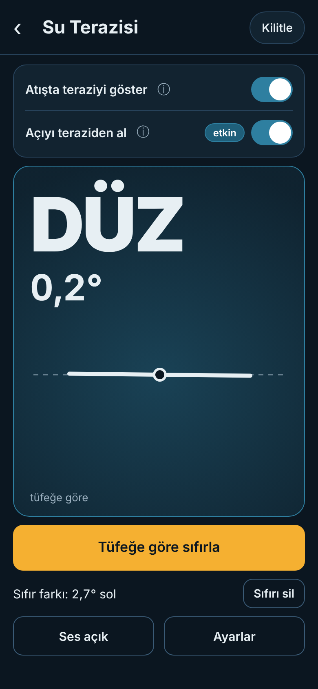 | DÜZ |
| 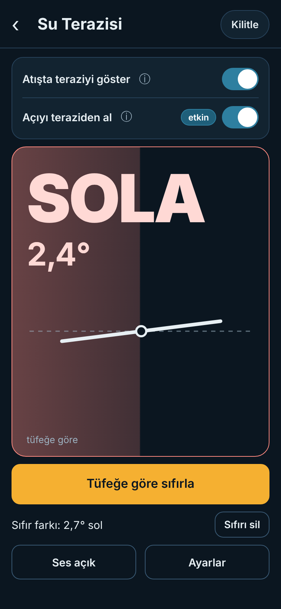 | SOLA |
| 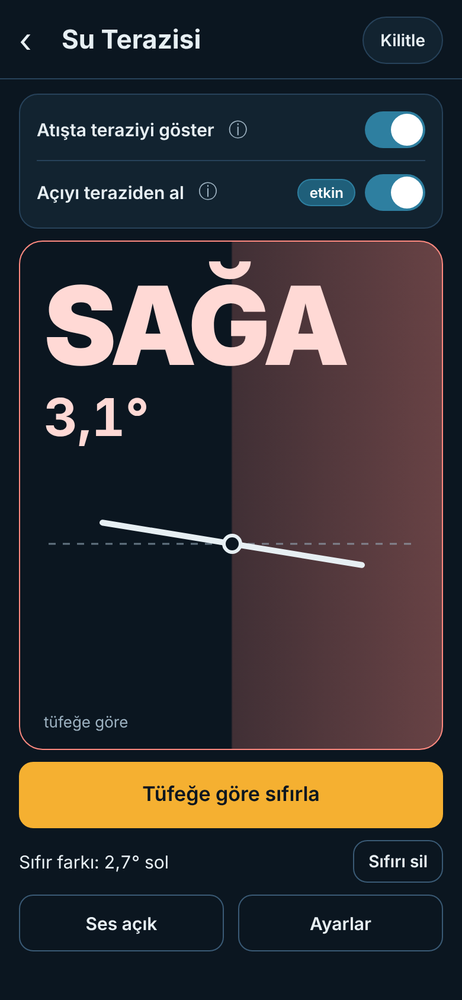 | SAĞA |
| 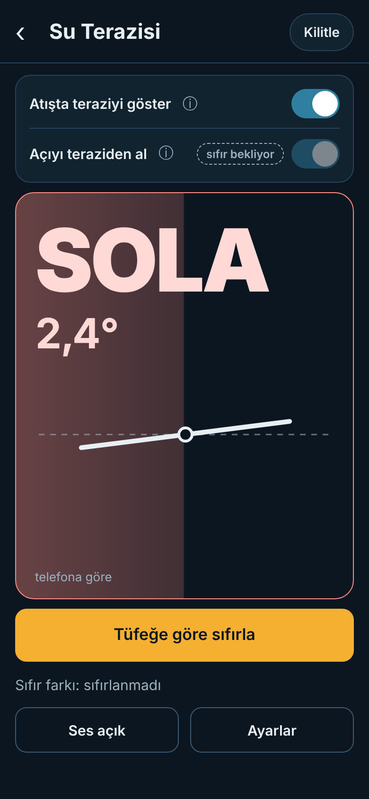 | Henüz tüfeğe göre sıfırlanmadı |

- Üstte iki anahtar, ikisi de ⓘ'li ve **varsayılan açık**: "Atışta teraziyi göster", "Açıyı teraziden al".
- Ortada büyük gösterge: **SOLA / SAĞA / DÜZ** iri harflerle + derece.
  - DÜZ: kutu koyu mavi ışıkla dolar.
  - SOLA / SAĞA: tüfeğin yattığı **yarı** uyarı rengiyle (#FF8A80, saydam) dolar.
  - Kalın çizgi tüfeğin kendi yatayıdır; yattığı taraf aşağıdadır. Kesikli çizgi gerçek yataydır.
    Küçük açılar da görünsün diye çizginin eğimi büyütülür: `En büyük açı`da 30° çizilir.
  - Altta küçük "tüfeğe göre" (sıfırlanmışsa) ya da "telefona göre" (sıfırlanmamışsa).
- Altta büyük **"Tüfeğe göre sıfırla"** (ana düğme), altında "Sıfır farkı: 2,7° sol" + **"Sıfırı sil"**,
  en altta **"Ses açık" | "Ayarlar"**. "Kilitle" bugünkü gibi kalır, üst çubukta.
- Sıfırlanmadıysa: "Açıyı teraziden al" açık ama **beklemede** (soluk anahtar + "sıfır bekliyor" etiketi);
  açı elden ya da kameradan gelmeye devam eder. "Tüfeğe göre sıfırla" yapılınca "etkin" olur.
  "Sıfırı sil" yine beklemeye alır.
- Telefon düz yatınca (yüzey ölçümü) bugünkü dairesel kabarcık "Halka" göstergesiyle görünür;
  SOLA/SAĞA yazısı dik duruş içindir. Bugünkü X/Y değerleri, kalibrasyon, kilit, açı birimi korunur.

**"Atışta teraziyi göster" açıkken Hedef sayfası**

| 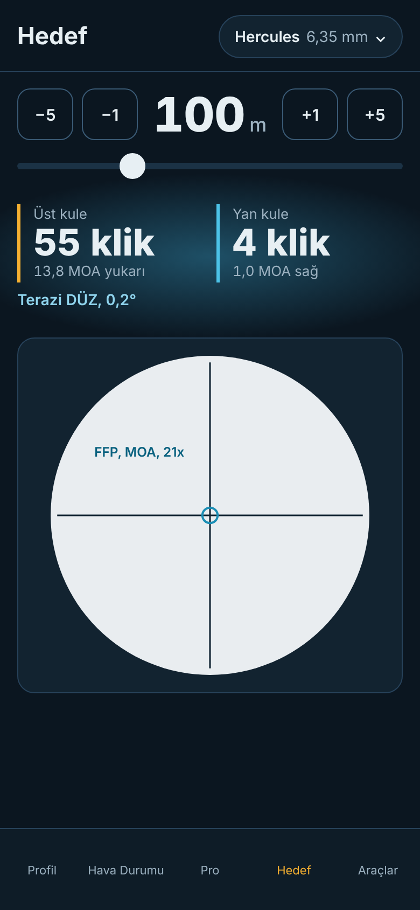 | 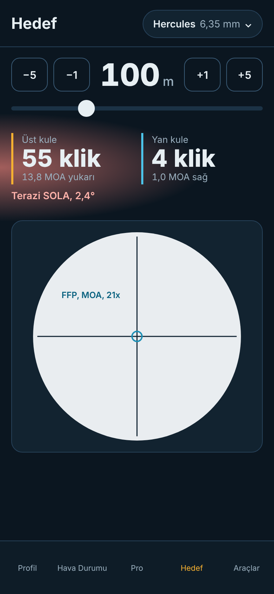 | 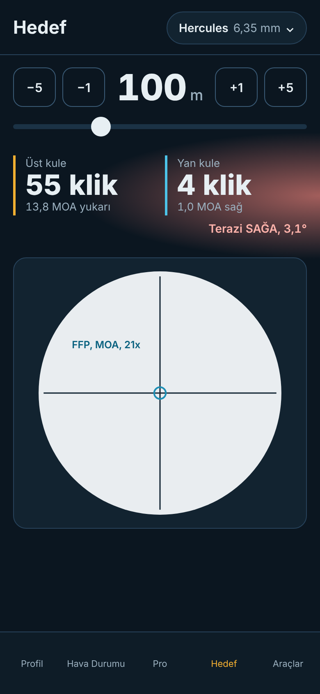 |
|---|---|---|
| DÜZ | SOLA | SAĞA |

- Üst kule / Yan kule değerlerinin **arkasında** ışıma: DÜZ ortada hafif mavi; SOLA solda, SAĞA sağda
  uyarı renginde. Altında tek satır: "Terazi SOLA, 2,4°" (SAĞA'da sağa yaslı).
- Atış anında sesli uyarı: DÜZ'de ses yok. SOLA ve SAĞA iki ayrı ses deseniyle (öneri: SOLA alçalan iki
  nota, SAĞA yükselen iki nota) ayırt edilir. Bip, yatıklık arttıkça hızlanır; `En büyük açı`da en hızlıdır.
- Hesap değişmez: bu anahtar yalnız göstergedir.

**"Açıyı teraziden al" etkinken Pro Ayarlar**

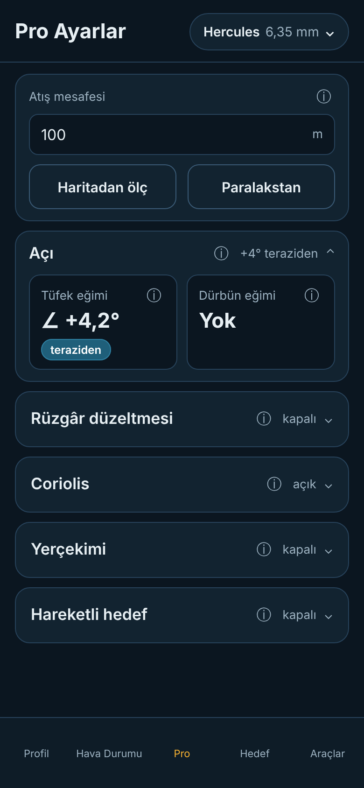

- Açı bölümünde Tüfek eğimi kutusunda "teraziden" etiketi; başlık özeti "+4° teraziden".

### C) Terazi ayarları (Ayarlar düğmesi, alttan açılan sayfa)

| 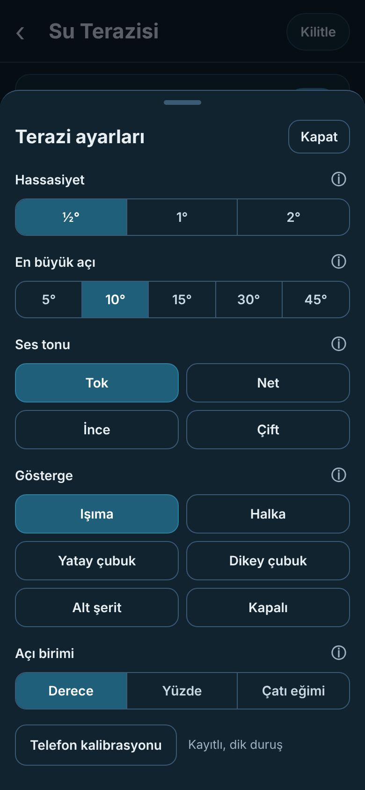 | 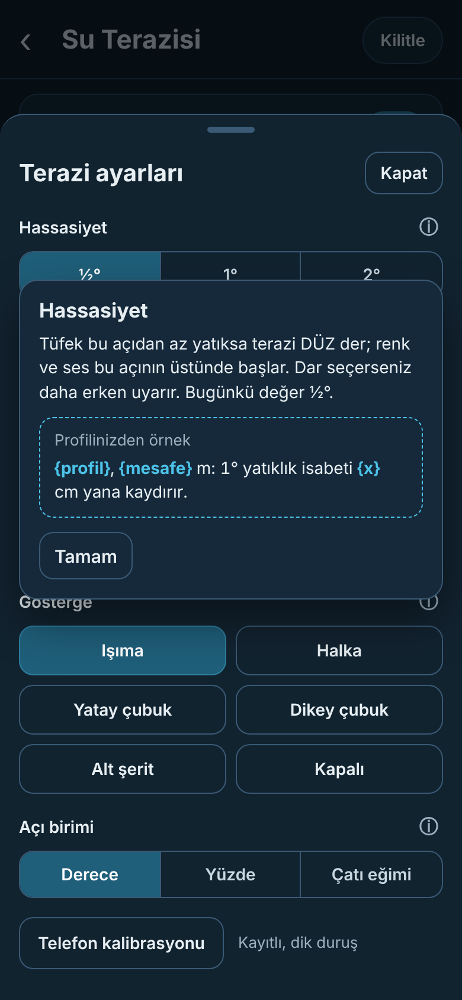 |
|---|---|
| Ayarlar | Hassasiyet ⓘ (eğim etkisi örneği yeri) |

- **Hassasiyet** ½° / 1° / 2°: DÜZ sayılan en büyük yatıklık; renk ve bip bunun üstünde başlar.
  Varsayılan ½° = bugünkü `TiltMath.levelToleranceDeg` (0,5°).
- **En büyük açı** 5° / 10° / 15° / 30° / 45°: bip bu açıda en hızlıdır.
- **Ses tonu**: 4 ton (öneri adları Tok, Net, İnce, Çift), dokununca çalar. Tonlar bizim, sonradan
  programla üretilir (bugünkü `tools/sounds/make_turret_click.py` gibi); indirilmiş veya kopya ses yok.
  Çalmak için bugün projede olan `audioplayers` yeterli; yeni paket yok.
- **Gösterge**: Işıma / Halka / Yatay çubuk / Dikey çubuk / Alt şerit / Kapalı. Bugünkü üç görünümle birleşir:

  | Bugün (`LevelViewType`) | Yeni |
  |---|---|
  | çubuk (torpedo) | Yatay çubuk |
  | dairesel (bullseye) | Halka |
  | tümü (all) | **kalkar** (silinir); yerine varsayılan Işıma |
  | — | Dikey çubuk, Alt şerit, Kapalı (yeni) |

  Gösterge hem Terazi sayfasında hem Hedef sayfasındaki uyarıda kullanılır. "Kapalı": Hedef sayfasında
  görsel yok, yalnız ses. Bugünkü görünüm seçimi kaydedilmiyor; silinecek kayıtlı veri yok.
- Bugünkülerden kalanlar: **Açı birimi** (Derece / Yüzde / Çatı eğimi) ve **Telefon kalibrasyonu**
  (Dört yüzey kalibrasyonu, kayıtlı).
- **Eğim etkisi örneği** Hassasiyet ⓘ içinde: "{profil}, {mesafe} m: 1° yatıklık isabeti {x} cm yana kaydırır."
  {x} sonradan aktif profilden bizim çözücümüzle hesaplanır (`aerodynamic_trajectory_solver`, `cantDeg`
  zaten var). Sabit dış sayı yok. Profil yoksa bu kutu görünmez.

## Kod haritası (salt okunarak doğrulandı, main d4abfac)

| Özellik | Bizde var mı (dosya) | Yeni mi | Hesaba nasıl girer |
|---|---|---|---|
| Pusula yönü | Var: `lib/features/tools/compass_screen.dart`, `lib/tools/state/compass_controller.dart`, `flutter_compass_heading_provider.dart`, `CompassMath.cardinal16` | Saha'da yeni kullanım | Kilitlenince Coriolis Atış yönü (`azimuthText`, `azimuthFromCompass`) → Coriolis |
| Atış açısı | Var: kamera ekranı `incline_measure_screen.dart`, `ShotAngleMath.inclineDeg` | Saha'da kamerasız canlı okuma yeni | Kilitlenince `inclineDeg` (Tüfek eğimi) |
| Pusuladan al (Pro) | Var: `pro_ayarlar_view.dart` `pro-azimuth-compass` | Hayır | Aynı (Atış yönü) |
| Rüzgâr hızı / yönü | Var: `hava_durumu_view.dart` (`wind`, `windHour`, `WindClockPicker`), kayıt `weatherSi['wind']`, `['windDirection']`, `windDirectionAtMs` | Hayır | Bugünkü rüzgâr girdisi; Saha yalnız bu kutuları doldurur |
| Hedefe göre rüzgâr saati | Yok (`CompassMath.normalize` var) | Yeni | Rüzgâr yönü kutusuna saat olarak |
| Telefonla rüzgâr yönü | Yok (pusula var) | Yeni | Aynı saat hesabıyla |
| Hava servisi rüzgârı | Var: `met_no_weather_provider.dart` (`windSpeedMps`, `windFromDeg`), Araçlar Hava ekranı | Saha'da yalnız satır | Girmez (yalnız bilgi) |
| Hedef tipi seçici | Yok; Hedef çapı var (`targetSizeText`, Pro Hareketli hedef) | Yeni, kaynak kararı bekliyor | Hedef çapı → isabet olasılığı (WEZ) ve Hedef halkası |
| Su terazisi | Var: `level_screen.dart`, `level_controller.dart` | Görünüm yeni | Bugün girmez |
| Tüfeğe göre sıfırla | Kısmen: "Geçici referans" (yalnız bellekte) | Yeni: telefona kaydedilir | Doğrudan girmez; terazinin sıfırıdır |
| Kalibrasyon | Var, kaydediliyor (`sniper_turk.level.bias.*`) | Hayır | Girmez |
| Atışta teraziyi göster | Yok | Yeni | Girmez (ışıma + ses) |
| Açıyı teraziden al | Yok | Yeni | `inclineDeg` (Tüfek eğimi), "teraziden" etiketiyle |
| Hassasiyet | Sabit `TiltMath.levelToleranceDeg = 0.5` | Ayarlanabilir olur | Girmez |
| En büyük açı | Yok | Yeni | Girmez |
| Ses | Var: tek tık `SystemSound.click`, seviyeye girince; açık/kapalı kaydedilmiyor | Tonlar ve hızlanan bip yeni | Girmez |
| Gösterge | Var: `LevelViewType` tümü / çubuk / dairesel | Birleşir (yukarıdaki tablo) | Girmez |
| Dürbün eğimi | Var: `scope_cant_screen.dart`, `cantDeg` çözücüde | Hayır | Bugünkü gibi; değişmez |
| Eğim etkisi örneği | Çözücü `cantDeg` var | Yalnız ⓘ metni yeni | Girmez (yalnız bilgi) |

Bugün terazi ve pusula değerleri hesaba girmiyor; yalnız kamera açısı giriyor. Bu tasarımla giren
yeni yollar yalnız: Saha kilidi (Atış yönü, Tüfek eğimi, Rüzgâr hızı, Rüzgâr yönü) ve "Açıyı teraziden al"
(Tüfek eğimi). Hepsi bugünkü kutulara yazılır; formül değişmez.

## İzinler

Yeni izin **yok**.
- Pusula (yön): `flutter_compass`, bugün Pusula ve "Pusuladan al" ile zaten kullanılıyor.
- Hareket (açı, terazi): `NSMotionUsageDescription` zaten var (`tools/configure_ios_info_plist.py`).
- Konum: Saha kullanmaz (Enlem bugünkü gibi Pro Ayarlar'da).
- Kamera: Saha kullanmaz (kameralı açı ekranı bugünkü gibi kalır).
- Mikrofon: yok.

## Yeni kayıt anahtarları (eski kayıtlar yüklenmeye devam eder)

Telefon geneli (SharedPreferences, kalibrasyonun yanında). Anahtar yoksa varsayılan kullanılır:

| Anahtar | Değer | Yoksa |
|---|---|---|
| `sniper_turk.level.showOnShot` | bool | açık |
| `sniper_turk.level.angleFromLevel` | bool | açık |
| `sniper_turk.level.rifleZero.x` / `.y` | double, derece | sıfırlanmamış |
| `sniper_turk.level.toleranceDeg` | 0,5 / 1 / 2 | 0,5 |
| `sniper_turk.level.maxAngleDeg` | 5 / 10 / 15 / 30 / 45 | açık soru 2 |
| `sniper_turk.level.tone` | 0–3 | 0 |
| `sniper_turk.level.indicator` | `glow`, `ring`, `hbar`, `vbar`, `strip`, `off` | `glow` |
| `sniper_turk.level.sound` | bool | kapalı (bugünkü gibi) |

Profil başına (`ShotSettings` JSON). Yoksa boş / kapalı okunur:

| Anahtar | Değer |
|---|---|
| `sahaTargetAt` | hedef kilit zamanı (UTC ms) |
| `sahaWindAt` | rüzgâr kilit zamanı (UTC ms) |
| `inclineFromLevel` | bool, Tüfek eğimi teraziden mi |
| `sahaTargetType` | seçilen hedef tipi kimliği (kaynak kararından sonra) |

Var olan anahtarlar (`azimuth`, `aziCompass`, `incline`, `weather.wind`, `weather.windDirection`,
`windDirAt`, `targetSize`, `sniper_turk.level.bias.*`) aynı anlamla kullanılır; hiçbiri silinmez.

## ⓘ metinleri

| Yer | Metin |
|---|---|
| Saha › Hedef | Telefonun üst kenarını hedefe çevirin. Yön ve açı canlı ölçülür; "Hedefi kilitle" ile donar ve hesaba yazılır. Örnek: KKB 339°, +4,2°. |
| Saha › Yön | Hedefin pusula yönü: kuzeyden saat yönünde derece ve yön harfi. Coriolis'te Atış yönü olur. Telefondaki pusuladan gelir. Örnek: KKB 339°. |
| Saha › Açı | Hedefe bakış çizgisinin yatayla açısı. Yukarı +, aşağı −. Kilitlenince Tüfek eğimi olur. Örnek: +4,2°. |
| Saha › Rüzgâr | Rüzgârın nereden estiği ve hızı. Halkada oku sürükleyin ya da telefonu rüzgârın geldiği yöne çevirin. Saat hedefe göredir: hedef 12, sağınız 3. Örnek: saat 7, 3,5 m/s. |
| Saha › Rüzgâr hızı | Atış yerindeki rüzgâr hızı, m/s. Rüzgâr ölçerden ya da tahminle girin; kaydırıcıyla da seçilir. Örnek: 3,5 m/s. |
| Saha › Rüzgâr yönü | Rüzgârın NEREDEN estiği, saat olarak. Hedef 12, sağınız 3, arkanız 6, solunuz 9. Örnek: soldan arkadan esiyorsa 7 veya 8. |
| Saha › Hedef tipi | Hedefin türü; seçince Hedef çapı dolar. Liste kaynak kararından sonra gelecek. Örnek: — |
| Saha › Hedef çapı | Pro Ayarlar'daki Hedef çapı ile aynı kutu; bugünkü ⓘ metni (`EnvironmentFieldInfo.targetSize`) aynen kullanılır. Hedef tipi seçilince dolar. |
| Terazi › Atışta teraziyi göster | Açıkken Hedef sayfasında kule değerlerinin arkası tüfek yatıksa renklenir, atışta sesli uyarı gelir. Hesabı değiştirmez. Örnek: SOLA 2,4°. |
| Terazi › Açıyı teraziden al | Açıkken Tüfek eğimi tüfeğe takılı telefondan alınır. Önce "Tüfeğe göre sıfırla" gerekir; o zamana kadar açı elden ya da kameradan gelir. Örnek: +4,2°. |
| Terazi › Hassasiyet | Tüfek bu açıdan az yatıksa terazi DÜZ der; renk ve ses bu açının üstünde başlar. Bugünkü değer ½°. + eğim etkisi örneği (yukarıda). |
| Terazi › En büyük açı | Bip bu açıda en hızlıdır; yatıklık arttıkça bip hızlanır. Örnek: 10°. |
| Terazi › Ses tonu | Uyarı sesinin tonu; dokununca çalar. Ses kapalıysa çalmaz. Örnek: Tok. |
| Terazi › Gösterge | Yatıklığın nasıl görüneceği. Işıma Hedef sayfasında kule değerlerinin arkasında yanar; Kapalı'da yalnız ses kalır. Örnek: Işıma. |
| Terazi › Açı birimi | Bugünkü metin aynen kalır. |
| Pro › Açı › Tüfek eğimi (teraziden) | Bugünkü metne ek: "teraziden" yazıyorsa değer tüfeğe takılı telefondan geliyor; Terazi'de kapatılabilir. |

"Tüfeğe göre sıfırla" için ⓘ yok (düğme, değer girilmez). Kısa açıklaması Terazi sayfasının genel ⓘ'sine
eklenir: "Telefonu tüfeğe takın, tüfeği dik tutun ve dokunun; telefonun eğik takılması çıkarılır."

## Açık sorular (gerçek seçimler)

1. **Tam yarım saat**: 225° fark tam 7,5. (a) aşağı yuvarla → 7 (sahibin örneği), (b) yukarı → 8.
2. **En büyük açı varsayılanı**: (a) 10° (görselde), (b) başka bir değer.
3. **Saha kilidi ile "Açıyı teraziden al" çakışırsa** Tüfek eğimi hangisinden gelir: (a) son yapılan işlem,
   (b) terazi etkinse hep teraziden.
4. **"Açıyı teraziden al" hangi açı**: (a) yalnız Tüfek eğimi (görselde), (b) Tüfek eğimi + Dürbün eğimi.
5. **"Tüfeğe göre sıfırla" ile bugünkü "Geçici referans"**: (a) birleşir, Geçici referans silinir,
   (b) ikisi ayrı kalır.
6. **Hedef sayfasındaki sesli uyarı** Terazi'deki "Ses" düğmesine bağlı mı: (a) evet, tek ses ayarı,
   (b) hayır, "Atışta teraziyi göster" açıksa hep çalar.
7. **Saha'ya giriş**: (a) Araçlar'da yeni kart, (b) alt çubukta yeni sekme.

Varsayım (soru değil): Hedef kartındaki "saat" ölçüm saatidir (İstanbul), yön saati değil.

## Bilerek tasarlanmayanlar

- Rüzgâr ölçer bağlantısı, maç modu, birim seçimi (bugünkü birim ayarı geçerli).
- Rüzgâr sınıf kelimeleri ve ± rüzgâr belirsizliği.
- Hedef listesi içeriği ve ölçüleri (araştırma görevinin kararını bekliyor).
- Terazinin hesaba canlı yatıklık (Dürbün eğimi) olarak girmesi; istenmedi.
- Üyelik, satın alma, "PRO" rozeti.
- Garmin tarafı.

## Dosyalar

- `saha-*.html/png`, `terazi-*.html/png`, `hedef-*.html/png`, `pro-aci-teraziden.html/png`
- Açı sayıları ve hedef/hız değerleri yalnız görsel örnektir.

---
🤖 Generated with [Claude Code](https://claude.com/claude-code)
