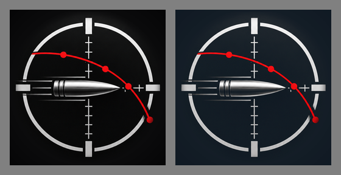

# Uygulama ikonu: siyah zemin → #0B1620

Sahip kararı: 2026-10-15 23:10 (İstanbul), önizleme görüldükten sonra
("Tamam öyle yapalım").

Solda eski ikon, sağda yeni ikon (256 px'e küçültülmüş, gri zemin üzerinde).

## Ne

- `branding/ios/AppIcon-1024.png` ikonunun siyah zemini uygulamanın zemin
  rengi **#0B1620** tonuna çevrildi.
- Beyaz retikül, gümüş mermi, hız çizgileri, kırmızı yörünge ve noktalar
  değişmedi.
- Yeni küçük betik: `tools/branding/recolor_icon_bg.py` (girdi ve çıktı yolu
  argüman, ağ yok).
- Yeni test: `tools/test_recolor_icon_bg.py`.
- Önce/sonra görseli: `docs/reports/ikon_zemin_once_sonra.png`.

## Nasıl

Önizlemedeki yöntemin aynısı, her piksel için:

- `w = clip(1 − max(R,G,B)/70, 0, 1)`
- kırmızı piksellerde (R > G+40 ve R > B+40) `w = 0`
- `çıkış = clip(giriş + w·(11, 22, 32), 0, 255)`, en yakın tam sayıya yuvarlanır.

Tam siyah #0B1620 olur; kenar yumuşatmalı pikseller yumuşak geçer; en parlak
kanalı 70 ve üstü olan pikseller (beyaz, gümüş, kırmızı) hiç değişmez.
Çıktı 1024×1024, RGB, alfa kanalı yok (App Store kuralı), PNG.

Komut: `python3 tools/branding/recolor_icon_bg.py eski.png branding/ios/AppIcon-1024.png`

## Neden

İkonun siyah zemini uygulamanın zemin rengiyle (#0B1620, tasarım README'si)
aynı olsun diye.

## Uç durumlar

- **Köşe rengi:** Eski ikonun zemini tam siyah değil, köşelerde (6, 6, 7),
  ortaya doğru biraz daha açık (hafif vinyet). Bu yüzden yöntem köşeyi tam
  #0B1620 değil **(16, 26, 36)** yapar (w = 0,9 → 6 + 0,9·(11, 22, 32)).
  Görevdeki "köşe (11, 22, 32) ±3 içinde" denetimi bu yöntemle tutmaz
  (fark 4–5). Önizlemede görülen yöntem değiştirilmedi; test, köşenin
  yöntemin verdiği değere (±1) eşit olduğunu ve mavi > yeşil > kırmızı
  (zemin tonu) olduğunu denetler. Köşenin tam #0B1620 olması istenirse
  bu ayrı bir karar (ör. eşik altını önce siyaha çekmek).
- Değişen piksel sayısı: 927 912; bunların hiçbiri en parlak kanalı ≥ 70
  olan ya da kırmızı piksel değil (betikle denetlendi).
- iOS'un kullandığı başka ikon kopyası yok: repoda `ios/` klasörü yok;
  iOS iskeleti CI'da `flutter create` ile üretiliyor ve
  `tools/configure_ios_branding.py` ikonu `branding/ios/` içinden
  `AppIcon.appiconset` içine kopyalıyor. Bu yüzden yalnız bu dosya değişti.

## Bilerek yapılmayan

- `assets/branding/logo_line*.png`, Garmin başlatıcı ikonu, açılış
  (LaunchImage) görselleri ve açılış zemin rengi değiştirilmedi.
- CI'a Pillow eklenmedi: test PNG'yi Python standart kütüphanesiyle okur;
  betik Pillow'u yalnız dosya okurken/yazarken yükler.
- Birleştirme (merge) ve TestFlight yok; PR taslak.

## Testler

- `python3 -m unittest discover -s tools -p 'test_*.py'` → 848 test, OK
  (`tools/test_configure_ios_branding.py` dahil).
- `python3 tools/offline_dart_lint.py` → PASS, 387 Dart dosyası, 0 sorun.
- `tools/test_recolor_icon_bg.py`: boyut 1024×1024, RGB (alfa yok); dört
  köşe yöntemin değerinde; eski dosyadan alınan retikül (100,520),
  (55,498), kırmızı nokta (388,628) ve orta (512,512) pikselleri aynen;
  saf siyah → (11, 22, 32), parlak/kırmızı değişmez, kenar geçişi.

## CI linkleri

- **iOS CI** (pull_request, commit 45132e2) — başarılı:
  https://github.com/sniperTurk/flutter-app/actions/runs/38800301975
  - `verify` (macOS: Python takımı, G1/G7 kapısı, iOS iskeleti + ikon
    kopyalama, App Store ön denetimi, Simulator derleme ve açılış testi,
    imzasız arşiv) — başarılı:
    https://github.com/sniperTurk/flutter-app/actions/runs/38800301975/job/116653375927
  - `dart-checks` (biçim, analiz, birim/widget testleri) — başarılı:
    https://github.com/sniperTurk/flutter-app/actions/runs/38800301975/job/116647280965
  - `wind-acceptance` — başarılı:
    https://github.com/sniperTurk/flutter-app/actions/runs/38800301975/job/116647280623
- **Biçim düzeltme (format-fix)** — başarılı, değişiklik yok (push olmadı):
  https://github.com/sniperTurk/flutter-app/actions/runs/38800299020
- Bu rapor güncellemesi yalnız belge değişikliği; iOS CI `docs/**` için
  yeniden çalışmaz.
- TestFlight / App Store: çalıştırılmadı.

---
🤖 Generated with [Claude Code](https://claude.com/claude-code)
