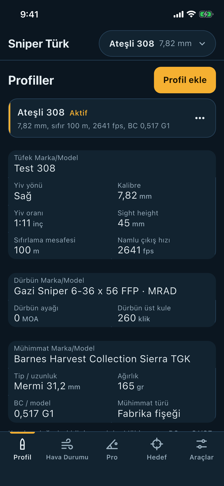

# Profil özeti: ateşli Mühimmat kartında Tip / uzunluk ve Mühimmat türü

Sahibin kararı (17.10.2026, 18:13–18:26 İstanbul): "Mermi 31.2 mm yazalım." · "Fabrika fişeği ve el dolumu ise aşağı yaz." · "PCP'yi boşver şimdi."

## Ne
Profil sayfasındaki Mühimmat kartı (`profile-summary-ammo`), yalnız ateşli tüfek profillerinde:
- "Tip" kutusu, kayıtlı mermi uzunluğu varsa **"Tip / uzunluk"** olur ve değeri **"Mermi 31,2 mm"** olur. Kutunun yeri Tip'in yeridir (ilk satır, solda).
- Kartın son kutusu olarak **"Mühimmat türü"** eklendi. Değeri "Fabrika fişeği" ya da "El dolumu".
- PCP kartı değişmedi. Başka kart, etiket, sıra ya da değer de değişmedi.

## Nasıl
- Ayraç **boşluk**. "BC / model" kutusu da iki değerini boşlukla birleştiriyor ("0,243 G7"), sahip de "Mermi 31.2 mm" demişti. Bu yüzden " · " kullanılmadı.
- Uzunluk virgüllü yazılıyor ("31,2"). Kartın kendi sayı biçimi kullanıldı; "mm" öteki birimler gibi ("165 gr") değerin hemen sağında.
- Mühimmat türü kaydedilmiyor; Profil editörü profili açarken onu mühimmat kaydından çıkarıyor. Kart aynı kuralı kullanıyor:
  - Kayıt fabrika fişeği listesindeyse "Fabrika fişeği".
  - Fabrika listesinde yok ama mermi listesinde varsa "El dolumu".
  - İkisinde de yoksa (elle yazılmış) "Fabrika fişeği". Editör de böyle açıyor.
- Model adı karşılaştırması için editörün kendi `_modelOf` fonksiyonu kullanıldı; iki yer birbirinden ayrışamaz.
- Değişiklik yalnız `lib/features/profiles/profile_summary.dart` içinde ve yalnız Mühimmat kartında.

## Neden
Sahip mermi uzunluğunu ve mühimmat türünü özet kartında görmek istedi. Ayrı bir "Mermi uzunluğu" kutusu istenmedi.

## Uç durumlar
- Uzunluk kayıtlı değil (ya da 0 veya geçersiz): etiket "Tip", değer "Mermi" kalır, ana daldaki gibi.
- Profilin mühimmatı bulunamıyor: Mühimmat türü "—" gösterir. Bu, kartın mevcut boş değer kuralı ("BC / model" de değeri yoksa "—" gösteriyor).
- Elle yazılmış bir el dolumu mermi, editörde olduğu gibi "Fabrika fişeği" görünür. Bu editörün mevcut davranışı; ayrı bir görev gerekir.
- Ateşli tüfeğe yanlışlıkla PCP mühimmatı bağlıysa (bozuk eski kayıt) kart "Fabrika fişeği" gösterir; editör bu mühimmatı hiç göstermez. Kayıtlı veri silinmez.
- Hesaba hiçbir etkisi yok; kart yalnız bilgi gösterir.

## Bilerek yapılmayan
- PCP kartı.
- Dürbün kartı: açık olan `fix/ozet-klik-degeri` dalı aynı dosyada onu değiştiriyor; bu dal ona dokunmuyor.
- Editörde ve öteki sayfalarda hiçbir değişiklik yok.

## Testler
Yeni dosya `test/ozet_mermi_uzunlugu_test.dart`, gerçek Profil sayfası (HomeScreen) üzerinde:
- Ateşli, uzunluk 31,2, fabrika fişeği: "Tip / uzunluk" / "Mermi 31,2 mm" Tip'in yerinde (dikey ±0,5 pt). "Mühimmat türü" / "Fabrika fişeği" son kutu. Kartın bütün yazıları sırasıyla kontrol ediliyor.
- El dolumu (Hornady 168 gr ELD Match): "El dolumu".
- Uzunluk yok: "Tip" / "Mermi", ana daldaki gibi.
- PCP: kartın yazıları ana daldakiyle birebir aynı ("Tip" / "Pellet", Mühimmat türü yok).
- 320 pt ve yazı ölçeği 1.3 ile 390 pt'de taşma yok.

Değiştirilen ya da zayıflatılan eski test yok. Kutu sayan ya da ateşli "Tip" değerini uzunlukla kontrol eden mevcut test yoktu (`profile_summary_order_test.dart` PCP profili kullanıyor). Ekran görüntüsü sürücüsü olarak `integration_test/ozet_mermi_uzunlugu_screens_test.dart` eklendi.

Yerel kontroller:
- `python3 tools/offline_dart_lint.py`: PASS (435 dosya, 0 sorun).
- `python3 -m unittest discover -s tools -p 'test_*.py'`: 915 test, OK (1 atlandı).
- Yerel `flutter test` çalıştırılamadı (BLOCKED): bu ortamda Flutter SDK indirilemiyor, ağ politikası storage.googleapis.com'u engelliyor. Flutter testleri CI'da koştu.

## Ekran görüntüsü
Simülatör, iPhone 16e (390 pt), iOS 26.2. Ateşli profil, Barnes fabrika fişeği, uzunluk 31,2 mm:

Çalıştırma: https://github.com/sniperTurk/flutter-app/actions/runs/39045787605 (success, integration test exit 0)

## CI
Kod commit'i `0583aa3` üzerinde:
- iOS CI (PR): `dart-checks` success, `wind-acceptance` success, `verify` success. ios-simulator bu iş akışında atlandı (skipped). https://github.com/sniperTurk/flutter-app/actions/runs/39046249876
- Tam `flutter test` (test-diag, files=test): success. https://github.com/sniperTurk/flutter-app/actions/runs/39046247983
- `flutter analyze --fatal-infos --fatal-warnings` (analyze-diag): success. https://github.com/sniperTurk/flutter-app/actions/runs/39046249902
- dart format (375209577): değişiklik gerekmedi, success. https://github.com/sniperTurk/flutter-app/actions/runs/39045781408
- İlk commit `09a238c`'de analyze bir test hatası buldu (const haritada tekrar eden anahtar). `0583aa3` ile düzeltildi.

Bu rapor commit'i yalnız belge ve PNG ekliyor; onun CI sonucu PR açıklamasının sonunda.

Draft PR. Birleştirme ve TestFlight yapılmadı.

🤖 Generated with [Claude Code](https://claude.com/claude-code)

https://claude.ai/code/session_01B868WiXdRWJugrf5TaT8p6
