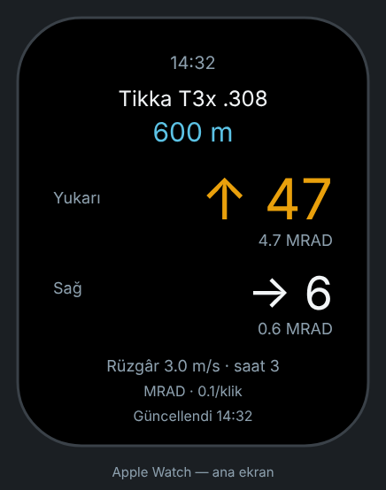
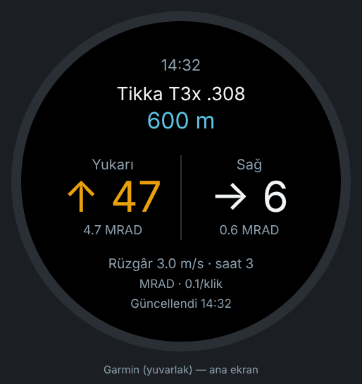
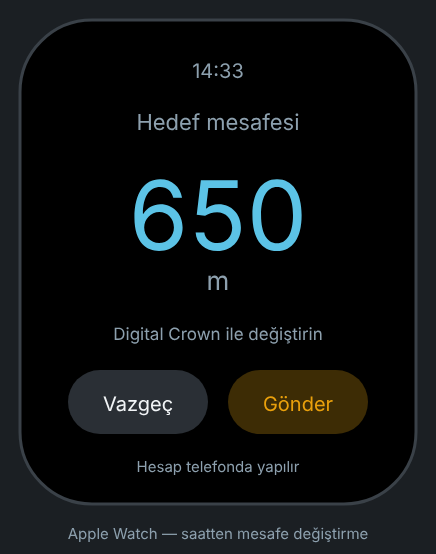
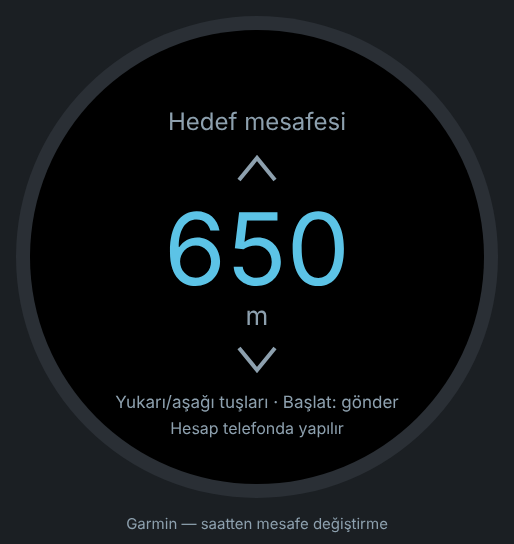
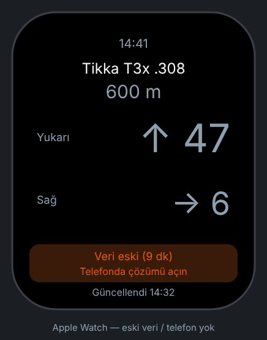
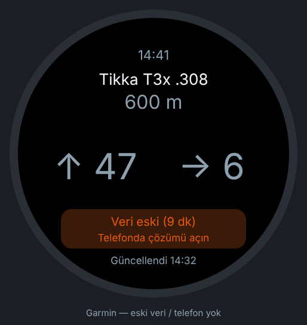

# Saat ekran taslakları

Uygulama kodundan önce görsel onay için. Değerler uydurmadır (yerleşim
örneği), hiçbir hesaptan gelmez.

| Ekran | Apple Watch (45 mm) | Garmin (yuvarlak, 454 px) |
|---|---|---|
| Ana ekran |  |  |
| Saatten mesafe değiştirme |  |  |
| Eski veri / telefon yok |  |  |

Kurallar: Türkçe, kalın yazı yok, sade; koyu zemin (OLED, gece görüşü).
Turuncu = yukarı/aşağı kliki, açık mavi = mesafe, beyaz = sağ/sol kliki.

Yeniden üretmek: `python3 uret.py` (SVG). PNG'ler aynı SVG'lerin Chromium ile
1:1 ekran görüntüsüdür.
